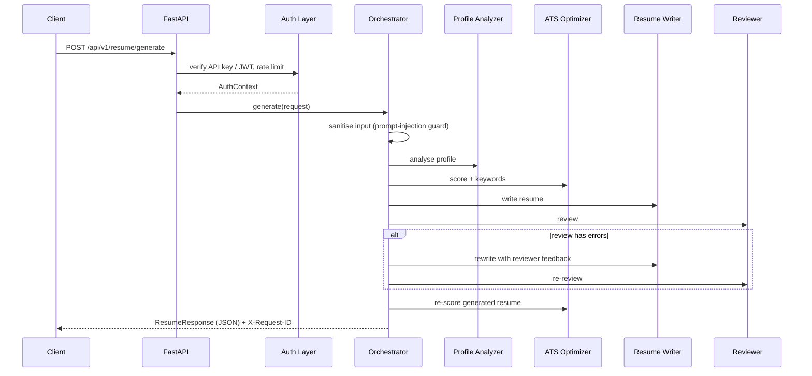

# Enterprise AI Resume Generator Agent

A production-style, multi-agent system that turns a candidate profile into an
ATS-optimised, professionally reviewed resume, delivered as structured JSON over a secured REST API.

> **Design goal:** a scalable, secure, observable AI *workflow*, not a chatbot.
> Four specialised agents collaborate through an orchestrator, every step is traced
> and measured, and the system keeps working even when the LLM provider is unavailable.

---

## 1. Architecture

```
User / API Request
        │
        ▼
┌──────────────────────────────┐
│ FastAPI Endpoint             │  request ID · size limit · security headers · access log · metrics
└──────────────┬───────────────┘
               ▼
┌──────────────────────────────┐
│ Authentication Layer         │  API key or JWT bearer · per-client rate limiting
└──────────────┬───────────────┘
               ▼
┌──────────────────────────────┐
│ Orchestrator                 │  input sanitisation · pipeline timeout · revision loop
│  ├── Profile Analyzer Agent  │  level, domain, years, strengths, gaps
│  ├── ATS Optimization Agent  │  keywords, ATS score, suggestions
│  ├── Resume Writer Agent     │  summary, bullets, skills, projects
│  └── Reviewer Agent          │  grammar, consistency, formatting, fabrication guard
│        └─ errors? → feedback → Writer (bounded retry)
└──────────────┬───────────────┘
               ▼
Structured JSON Response (Pydantic-validated)
               ▼
Logs (JSON, PII-masked) + Monitoring (Prometheus /metrics)
```



### Hybrid AI design: deterministic facts, LLM language

| Concern | Who does it | Why |
|---|---|---|
| Years of experience, level, dates | Code | LLMs are unreliable at arithmetic; this must be exact |
| Keyword matching & ATS score | Code | Must be explainable and reproducible for audits |
| Skills list, employers, education | Code (from input only) | Prevents hallucinated credentials |
| Summary, bullet wording, strengths, advice | LLM (optional) | Where language models genuinely add value |
| Grammar / professionalism review | Rules + LLM (optional) | Mechanical fixes are deterministic; nuance from LLM |

Every LLM response is **schema-validated** before use. If the call fails, times out, or
returns invalid JSON, the agent falls back to its deterministic engine and records
`status: "fallback"` in the trace. An LLM outage therefore degrades quality, never availability.

---

## 2. Project structure

```
resume-agent/
├── app/
│   ├── main.py                 # App factory, middleware, error handlers
│   ├── orchestrator.py         # Multi-agent pipeline coordination
│   ├── api/routes.py           # Endpoints (thin; no business logic)
│   ├── agents/
│   │   ├── base.py             # BaseAgent: tracing, metrics, safe LLM calls
│   │   ├── profile_analyzer.py # Agent 1
│   │   ├── ats_optimizer.py    # Agent 2
│   │   ├── resume_writer.py    # Agent 3
│   │   ├── reviewer.py         # Agent 4
│   │   ├── knowledge.py        # Domain keyword banks, skill taxonomy, action verbs
│   │   └── text_utils.py       # Deterministic text processing & ATS scoring
│   ├── llm/
│   │   ├── client.py           # Provider abstraction: mock | anthropic | openai
│   │   └── prompts.py          # Versioned prompts with injection guardrails
│   ├── security/
│   │   ├── auth.py             # API key + JWT authentication, rate-limit dependency
│   │   ├── rate_limit.py       # Sliding-window limiter
│   │   └── sanitizer.py        # Prompt-injection & hidden-character filter
│   ├── models/schemas.py       # Pydantic contracts (request, agent outputs, response)
│   └── core/                   # config, JSON logging, metrics, exceptions
├── tests/                      # Unit, agent, and API integration tests
├── samples/                    # Example request and response
├── Dockerfile                  # Multi-stage, non-root image with healthcheck
├── docker-compose.yml          # Service + Prometheus, hardened container settings
├── .github/workflows/ci.yml    # Lint → test → Docker build
└── .env.example
```

---

## 3. Getting started

### Local

```bash
python -m venv .venv && source .venv/bin/activate     # Windows: .venv\Scripts\activate
pip install -r requirements-dev.txt
cp .env.example .env                                  # then edit API_KEYS
uvicorn app.main:app --reload
```

Open interactive API docs at **http://localhost:8000/docs** (disabled in production).

The default `LLM_PROVIDER=mock` needs no API key. To enable a real model:

```bash
LLM_PROVIDER=anthropic   # or openai
LLM_MODEL=claude-sonnet-5-5
LLM_API_KEY=sk-...
```

### Docker

```bash
cp .env.example .env
docker compose up --build
# API:        http://localhost:8000
# Prometheus: http://localhost:9090
```

### Tests

```bash
pytest            # unit + agent + API integration tests
ruff check app tests
```

---

## 4. API usage

**Option A: API key**

```bash
curl -X POST http://localhost:8000/api/v1/resume/generate \
  -H "Content-Type: application/json" \
  -H "X-API-Key: <your-key>" \
  -d @samples/sample_request.json
```

**Option B: short-lived JWT** (recommended for front-end clients)

```bash
TOKEN=$(curl -s -X POST http://localhost:8000/api/v1/auth/token \
  -H "Content-Type: application/json" -d '{"api_key":"<your-key>"}' | jq -r .access_token)

curl -X POST http://localhost:8000/api/v1/resume/generate \
  -H "Authorization: Bearer $TOKEN" -H "Content-Type: application/json" \
  -d @samples/sample_request.json
```

| Endpoint | Auth | Purpose |
|---|---|---|
| `POST /api/v1/resume/generate` | ✅ | Run the multi-agent pipeline |
| `POST /api/v1/auth/token` | API key in body | Exchange API key for JWT |
| `GET /health` | – | Liveness probe |
| `GET /ready` | – | Readiness probe |
| `GET /metrics` | – (internal only) | Prometheus metrics |

### Response (abridged, from `samples/sample_response.json`)

```json
{
  "request_id": "3f9c2a7e1b4d4e8f9a6c0d2e5b7f1a3c",
  "profile_analysis": { "candidate_level": "Mid-Level", "primary_domain": "Data Analytics", "years_experience": 5.4 },
  "ats_analysis": { "ats_score": 76, "optimized_ats_score": 89, "missing_keywords": ["Power BI", "SQL"] },
  "resume": { "professional_summary": "Results-driven Data Analyst with 5+ years of experience...", "experience": ["..."] },
  "review": { "approved": true, "quality_score": 100, "corrections_applied": ["...Analyse → analyze", "...tense aligned → 'Analyzed'"] },
  "metadata": { "llm_provider": "mock", "revision_count": 0, "agent_trace": ["... per-agent status & duration ..."] }
}
```

Errors always use one envelope:
`{"error": {"code": "validation_error", "message": "...", "request_id": "..."}}`

---

## 5. Agents

### Agent 1: Profile Analyzer
Merges overlapping employment periods to compute **years of experience**, maps them to a
**candidate level** (Entry < 2 yrs ≤ Mid < 6 ≤ Senior < 10 ≤ Lead/Principal, adjusted for senior titles),
and scores eight career domains using target role (×3), past titles (×2) and skill overlap (×1).
Also detects employment gaps over 6 months, missing metrics and missing credentials.

### Agent 2: ATS Optimization
Extracts required keywords from the job description (or the domain role profile when none is given),
handling aliases (`PowerBI` → `Power BI`) and special characters (`C++`, `CI/CD`). The score is a
transparent weighted formula:

| Component | Weight | Measures |
|---|---|---|
| Keyword match | 50 | Coverage of required keywords |
| Quantified impact | 20 | Share of bullets with metrics (full marks at 60%) |
| Action verbs | 15 | Share of bullets opening with a strong verb |
| Section completeness | 15 | Experience, skills, education, projects/certs, LinkedIn |

After writing, the agent **re-scores the generated resume** so improvement is measurable (`ats_score` → `optimized_ats_score`).
Missing keywords are surfaced as advice, never silently inserted.

### Agent 3: Resume Writer
Produces the summary, experience bullets (weak openers such as "responsible for creating" become "Created",
first-person subjects removed, quantified bullets first, max 5 per role), categorised skills,
and project descriptions. Factual sections are always built from validated input.
**Integrity rule:** a Mid-Level candidate targeting a "Senior" role is not given the "Senior" title.

### Agent 4: Reviewer
Quality gate that auto-fixes mechanical issues (spelling, tense, capitalisation, punctuation, duplicates)
and reports judgement issues by severity. Includes a **fabrication guard** that removes any skill not
present in the candidate's input. `quality_score = 100 − 15·errors − 5·warnings − 1·info`;
approval requires no errors and a score ≥ 60. Errors trigger one bounded rewrite cycle.

---

## 6. Enterprise security controls

| Threat | Control | Location |
|---|---|---|
| Unauthorised access | API key (constant-time compare) or JWT (HS256, pinned algorithm, exp/iss/scope checks) | `security/auth.py` |
| Abuse / cost attacks | Per-client sliding-window rate limit, `Retry-After` header | `security/rate_limit.py` |
| Oversized payloads | Content-Length limit (413) + max length on every field and list | `main.py`, `schemas.py` |
| Mass assignment | `extra="forbid"` on all request models | `schemas.py` |
| Prompt injection | Pattern filter, hidden-character stripping, untrusted-data delimiters in prompts | `sanitizer.py`, `prompts.py` |
| Hallucinated content | Schema-validated LLM output; facts from code; fabrication guard | `base.py`, `reviewer.py` |
| PII leakage | Contact details never sent to LLM; emails/phones masked in logs; no input echo in errors; `Cache-Control: no-store` | multiple |
| Log injection | Client `X-Request-ID` accepted only if it matches `^[A-Za-z0-9_-]{8,64}$` | `main.py` |
| Web attacks | `nosniff`, `X-Frame-Options: DENY`, CSP, HSTS (prod), restricted CORS | `main.py` |
| Insecure config | Startup fails in staging/production without strong `JWT_SECRET` and `API_KEYS` | `config.py` |
| Container compromise | Non-root user, read-only FS, all capabilities dropped, `no-new-privileges` | `Dockerfile`, compose |
| Information disclosure | API docs disabled in production; generic 500 messages | `main.py` |

---

## 7. Logging & observability

**Structured logs:** every line is one JSON object with `request_id`, so a full request
(HTTP → each agent → LLM calls) can be traced in ELK / Datadog / CloudWatch:

```json
{"timestamp":"2026-10-06T15:58:57+00:00","level":"INFO","logger":"agents.ats_optimizer",
 "event":"agent.completed","request_id":"3f9c2a7e...","agent":"ats_optimizer","status":"success","duration_ms":2.34}
```

**Metrics** at `/metrics` (Prometheus format):

| Metric | Type | Use |
|---|---|---|
| `http_requests_total{method,path,status}` | counter | Traffic & error rate |
| `http_request_duration_seconds` | histogram | Latency SLOs (p95/p99) |
| `agent_runs_total{agent,status}` | counter | Agent success / fallback / failure |
| `agent_duration_seconds{agent}` | histogram | Bottleneck detection |
| `llm_requests_total{provider,agent,outcome}` | counter | LLM reliability & cost tracking |
| `llm_fallbacks_total{agent}` | counter | Alert if LLM output is often rejected |
| `pipeline_runs_total{outcome}` | counter | End-to-end success rate |
| `auth_failures_total{reason}`, `rate_limited_total`, `security_flags_total` | counter | Security monitoring |
| `resumes_approved_total`, `resumes_flagged_total` | counter | Output quality trend |

**Per-request trace** is also returned in `metadata.agent_trace`, so clients and support teams can see
which agents ran, how long each took, and whether the LLM or fallback engine was used.

---

## 8. Production engineering principles applied

* **Separation of concerns:** routes → orchestrator → agents → utilities; each layer testable alone.
* **Dependency inversion:** agents depend on `BaseLLMClient`, so providers are swappable via config.
* **Fail fast, degrade gracefully:** invalid config stops startup; LLM failures fall back, not crash.
* **Bounded execution:** pipeline timeout, LLM timeout + retries with backoff, max one revision loop.
* **Twelve-factor config:** all settings from environment; no secrets in code or images.
* **Contract-first API:** Pydantic models generate OpenAPI docs and enforce the response shape.
* **Tested:** unit tests for scoring/security logic, agent tests (including LLM fallback via a fake client), and API integration tests.
* **CI/CD:** lint, test, and Docker build on every push.

---

## 9. Known limitations & future work

| Limitation | Production path |
|---|---|
| In-memory rate limiter and metrics are per-instance | Redis-backed limiter; `prometheus_client` / OpenTelemetry |
| Static keyword taxonomy | Learn keywords from job-posting corpus; embeddings for semantic matching |
| Synchronous request/response | Async job queue (Celery/RQ + Redis) with webhooks for long LLM runs |
| API keys in environment | Secrets manager (Vault, AWS Secrets Manager) with rotation |
| JSON output only | Renderer service for DOCX/PDF templates |
| No persistence | Store resumes (encrypted at rest) with retention policy for GDPR/CCPA |
| Rule-based grammar checks | Integrate LanguageTool alongside the LLM reviewer |
